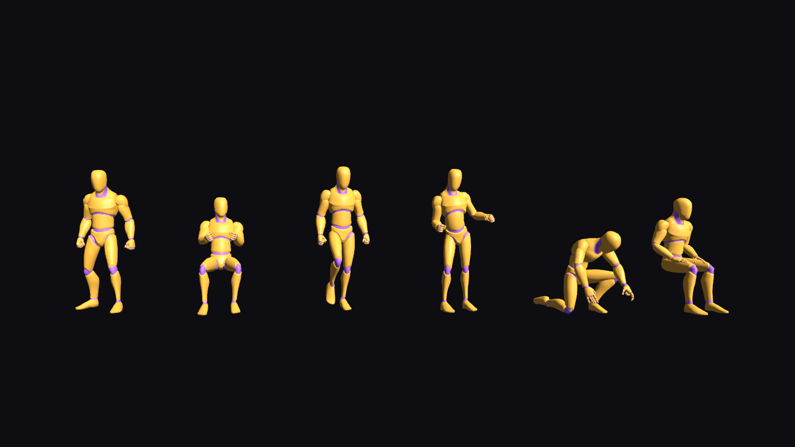

# Humanoid animation: the four packs

The owner gave the project four humanoid animation packs on 23 Oct 2026 (session 19, TRANSCRIPT:
"learn and store these"). Nothing in SpeedFest has a skeleton yet -- every car, block and tower is
procedural -- so this is the first character material in the repo. This page is the study of all
four: what each one holds, on which rig, how long each clip runs, how far it travels, and what it
would take to put it on screen in Godot 4.7.2.

Read with it: `stadium/assets/anim/CREDITS.md` (sources and licences),
`tools/anim/manifests/*.json` (the machine-readable inventories this page is drawn from).

| Pack | Author | Clips | Rig | Format | Licence | In the repo |
|---|---|---:|---|---|---|---|
| Universal Animation Library [Standard] | Quaternius | 43 | 65-bone Unreal-style, with a Mannequin mesh | `.glb` + `.fbx` | **CC0 1.0** | **yes**, `stadium/assets/anim/ual/` |
| Human Basic Motions 2.4 FREE | Kevin Iglesias | 118 | 56-bone Blender-style, two body meshes | `.fbx` | Unity Asset Store EULA | no (see below) |
| Motifect Emotes & Social v1.0 | Motifect AI | 30 | 77-bone, no mesh | `.fbx` + `.bvh` | free in a project, no redistribution | no |
| Motifect Daily Life v1.0 | Motifect AI | 40 | the same 77-bone rig | `.fbx` + `.bvh` | the same | no |

## Licences, and why only one pack is committed

This repository is public, so committing a pack publishes it. Only Quaternius' library is under a
licence that allows that (CC0: public domain). The other three are licensed for **use in a
project** and expressly not for passing the source clips on:

- **Human Basic Motions** ships under the Unity Asset Store Standard EULA ("royalty-free and
  allowed for commercial use", "resale not allowed", keviniglesias.com/#license). That covers the
  clips inside a built game; a public repo of the `.fbx` files is distribution of the asset itself.
- **Motifect** states it plainly in its READMEs: "Free for personal and commercial use in your
  projects. Do not redistribute or resell these raw animation files as a standalone product."

So all four may be **used in SpeedFest** and shipped inside a build. Three of them live only with
the owner, staged when needed:

    tools/anim/stage_packs.sh <dir holding the four zips>

which unpacks them into the untracked `assets/anim/` at the repo root (where the owner's other
source material already sits) and rebuilds `tools/anim/manifests/*.json`. Everything this page
knows was measured from the files, so a later agent needs the originals only to use them, never to
plan with them. If the owner would rather have all four in the repo, that is their call to make --
the two Motifect packs are the easier case, since only "redistribute ... as a standalone product"
is forbidden; the Unity EULA pack is the one to leave out either way.

## Three rigs, and how they line up

No two packs share a skeleton, so mixing any two means retargeting. The bones that matter map
cleanly; the differences are at the ends (fingers, jaw, eyes, toe tips).

| Godot `SkeletonProfileHumanoid` | Universal Animation Library | Human Basic Motions | Motifect |
|---|---|---|---|
| Root | `root` | `B-root` | -- (`Hips` is the root) |
| Hips | `pelvis` | `B-hips` | `Hips` |
| Spine | `spine_01` | `B-spine` | `Spine1` |
| Chest | `spine_02` | -- | `Spine2` |
| UpperChest | `spine_03` | `B-chest` | `Chest` |
| Neck | `neck_01` | `B-neck` | `Neck1` (+ `Neck2`) |
| Head | `Head` | `B-head` | `Head` |
| LeftShoulder | `clavicle_l` | `B-shoulder.L` | `LeftShoulder` |
| LeftUpperArm | `upperarm_l` | `B-upperArm.L` | `LeftArm` |
| LeftLowerArm | `lowerarm_l` | `B-forearm.L` | `LeftForeArm` |
| LeftHand | `hand_l` | `B-hand.L` | `LeftHand` |
| LeftUpperLeg | `thigh_l` | `B-thigh.L` | **`LeftLeg`** |
| LeftLowerLeg | `calf_l` | `B-shin.L` | **`LeftShin`** |
| LeftFoot | `foot_l` | `B-foot.L` | `LeftFoot` |
| LeftToes | `ball_l` | `B-toe.L` | `LeftToeBase` |
| fingers | `index_01_l` ... (3 joints + a `_leaf` tip) | `B-indexFinger01.L` ... (3) | `LeftHandIndex1` ... (4 + an `End` tip) |

Watch for these:

- **Motifect's leg names are a trap.** `LeftLeg` is the *thigh* and `LeftShin` the calf. In Mixamo's
  naming, which the rest of the rig resembles, `LeftLeg` is the calf and the thigh is `LeftUpLeg`.
  A bone map built on the resemblance puts the thigh's rotation on the shin and the character folds.
- **Human Basic Motions has one spine joint fewer** (`B-spine` then `B-chest`, no middle), so a
  clip retargeted onto it loses the middle-spine bend; the reverse gives the extra bone nothing.
- `B-spineProxy` is **not in the chain**: it hangs off `B-root` beside `B-hips` as a helper. It is
  animated, so a naive "copy every bone by name" picks it up and gets nothing useful.
- Motifect carries a `Jaw`, `LeftEye` and `RightEye`, Human Basic Motions a `B-jaw` and a
  `B-handProp.L/R` socket for a held object, the Universal library neither. Tip bones differ:
  `_leaf` (Quaternius), `End` (Motifect), none (Kevin Iglesias).

Godot 4.7.2 does the retargeting itself: in a scene's Advanced Import Settings, select the
skeleton and give it a **BoneMap** over `SkeletonProfileHumanoid`, filled in from the column above
for that pack. The import then rewrites the tracks onto the profile's names and rest pose, which
is what makes clips from different packs playable on one character.

## Universal Animation Library [Standard] -- Quaternius, CC0 (in the repo)

`stadium/assets/anim/ual/ual_standard.glb` and `ual_standard_rm.glb`, 7.6 MB each. The pack also
ships Unity `.fbx` builds of the same 43 clips; they are redundant for us and are left out.

Verified in Godot 4.7.2 (`godot --headless --path stadium -s ...`): both files import as they are,
each giving one `AnimationPlayer` with **43 animations, 66.2 s in total**, over a **65-bone**
skeleton, plus a `Mannequin` mesh of 13,744 triangles, 1.83 m tall (head joint at 1.569 m). No
textures: two plain materials, which suits a stand-in.

The two files hold the same clips: `_rm` bakes the travel into the `root` bone, the other keeps the
character on the spot. **Godot's importer eats the `_Loop` suffix** (`nodes/use_name_suffixes`) and
turns it into the clip's loop mode, so `Walk_Loop` arrives as `Walk`, looping, and `Death01` as
`Death01`, not looping. Names below are the ones in the file; drop `_Loop` for the name in the game.
Travel is measured from the `_rm` file's root track.

| Clip | s | Root motion (`_rm`) |
|---|---:|---|
| `A_TPose` | 2.50 | in place |
| `Crouch_Fwd_Loop` | 2.00 | 1.50 m, 0.75 m/s |
| `Crouch_Idle_Loop` | 2.93 | in place |
| `Dance_Loop` | 1.00 | in place |
| `Death01` | 2.40 | 0.65 m, 0.27 m/s |
| `Driving_Loop` | 1.67 | in place |
| `Fixing_Kneeling` | 5.20 | in place |
| `Hit_Chest` | 0.33 | in place |
| `Hit_Head` | 0.43 | in place |
| `Idle_Loop` | 2.50 | in place |
| `Idle_Talking_Loop` | 2.93 | in place |
| `Idle_Torch_Loop` | 1.27 | in place |
| `Interact` | 2.00 | in place |
| `Jog_Fwd_Loop` | 0.93 | 5.00 m, 5.36 m/s |
| `Jump_Start` / `Jump_Loop` / `Jump_Land` | 1.33 / 2.50 / 1.27 | in place |
| `PickUp_Table` | 0.83 | in place |
| `Pistol_Aim_Down` / `_Neutral` / `_Up` | 0.17 each | in place |
| `Pistol_Idle_Loop` / `Pistol_Reload` | 1.67 / 1.67 | in place |
| `Pistol_Shoot` | 0.63 | in place |
| `Punch_Cross` / `Punch_Jab` | 1.00 / 0.87 | in place |
| `Push_Loop` | 2.67 | 0.80 m, 0.30 m/s |
| `Roll` | 1.47 | 4.99 m, 3.40 m/s |
| `Sitting_Enter` / `Sitting_Exit` | 1.30 / 1.03 | in place (the pelvis moves, not the root) |
| `Sitting_Idle_Loop` | 1.67 | in place |
| `Sitting_Talking_Loop` | 2.93 | in place |
| `Spell_Simple_Enter` / `_Idle_Loop` / `_Shoot` / `_Exit` | 0.53 / 2.10 / 0.50 / 0.43 | in place |
| `Sprint_Loop` | 0.67 | 5.50 m, 8.25 m/s |
| `Swim_Fwd_Loop` / `Swim_Idle_Loop` | 1.33 / 3.33 | 2.90 m, 2.18 m/s -- / in place |
| `Sword_Attack` / `Sword_Idle` | 1.53 / 1.67 | 1.50 m, 0.98 m/s -- / in place |
| `Walk_Loop` / `Walk_Formal_Loop` | 1.33 each | 1.30 m, 0.98 m/s |

The locomotion is **stylised, not measured**: a walk at 0.98 m/s is life-like, but the jog covers
5.0 m in a 0.93 s cycle (5.36 m/s) and the sprint 5.5 m in 0.67 s (8.25 m/s, about a world record),
with strides to match. Drive them at the speed the clip implies, or slow the playback and accept
shorter strides -- do not move a character at 8 m/s because the clip says so.

For SpeedFest the useful ones are `Driving_Loop`, `Sitting_Enter/Idle/Exit` (a driver in a car),
`Idle`, `Walk`, `Jog`, `Dance`, `Interact`, `PickUp_Table`, `Push` and `Fixing_Kneeling` (a
mechanic in the Garage). Roughly a third of the pack is fantasy/shooter (`Pistol_*`, `Spell_*`,
`Sword_*`, `Punch_*`) and will never be used here.

## Human Basic Motions 2.4 FREE -- Kevin Iglesias (with the owner, not in the repo)

118 clips in 120 `.fbx` files, 95.8 s in total, FBX 7700, **Z up, units in centimetres**, 30 fps,
on a 56-bone Blender-named rig (`B-root`, `B-hips`, ... with `.L`/`.R` sides) under a `Rig` null.
Two body meshes come with it: `HumanF_BodyMesh` (10,746 vertices) and `HumanM_BodyMesh` (5,392),
plus one colour-palette texture.

It is a **locomotion set**, which is exactly what the other three packs lack:

| Group | Clips | Per clip | Measured |
|---|---:|---|---|
| Walk | 32 | 0.80 s cycle, 8 directions, female and male, each with and without root motion | 1.60 m per cycle = **2.00 m/s** |
| Run | 32 | 0.60 s, the same 8 directions | 2.40 m = **4.00 m/s** |
| Sprint | 20 | 0.53 s, 5 directions (no backward) | 3.20 m = **6.00 m/s** |
| Idles | 8 | `Idle01`, `Idle02` (2.70 s each) and the transitions between them (0.67 / 0.77 s) | in place |
| Jump | 12 | `Jump01` 1.53 s whole, or `- Begin` / `- Land` (0.67 s each), and `Fall01` 1.00 s | `[RM]` lifts the root 1.00 m straight up and sets it down again -- no forward travel |
| Turn | 8 | `Turn01_Left` / `_Right`, 1.00 s | turns on the spot, no travel |
| Talk | 2 | `Talk01`, 2.27 s | in place |
| Masked poses | 2 | `HandsClosed01`, `ObjectGripHands01` -- static, for a hand layer over another clip | -- |

The eight directions are forward, back, left, right and the four diagonals; every diagonal travels
the same total distance as the straight one (169.7 cm per axis = 240 cm for a run), so a 2D blend
space over them needs no per-direction speed correction. The `[RM]` files put the travel on
`B-root` and are otherwise identical, so a blend tree can use the in-place set and take the speed
from the table above.

Why it matters: these are the only clips in the four packs that make a **crowd walk convincingly**
-- an 8-way set at three speeds, with turns and idles, male and female.

## Motifect Emotes & Social v1.0 (with the owner, not in the repo)

30 clips, 190 s, on a 77-bone rig, shipped twice: `.fbx` (Y up, centimetres, 30 fps) and `.bvh`
(the same motion as text). No mesh. The clips are long by game standards -- 4 to 10 s -- and
generated by Motifect's AI rather than captured, which shows in places (below).

| Clip | s | Travel |
|---|---:|---|
| `arms_crossed_defiant` | 10 | in place |
| `bow_deep_respect` | 6 | in place |
| `challenge_stance` | 10 | in place |
| `cheer_arms_raised` | 6 | in place |
| `clap_enthusiastic` | 6 | in place |
| `cover_face_embarrassed` | 7 | in place |
| `dance_arm_wave` | 10 | in place |
| `dance_simple_groove` | 10 | in place |
| `excited_spin` | 6 | in place |
| `explain_wide_gesture` | 6 | in place |
| `facepalm` | 5 | in place |
| `fist_pump_victory` | 5 | in place |
| `hold_up_wait` | 4 | in place |
| `jump_for_joy` | 6 | in place |
| `laugh_body` | 10 | in place |
| `no_way_hands_out` | 5 | in place |
| `point_at_opponent` | 4 | in place |
| `salute_military` | 5 | in place |
| `shrink_away_scared` | 5 | 0.69 m backwards |
| `shrug_i_dont_know` | 5 | in place |
| `sit_and_wave_goodbye` | 6 | in place |
| `slump_defeated` | 6 | in place |
| `stomp_frustrated` | 4 | in place |
| `talk_animate_hands` | 10 | in place |
| `taunt_come_here` | 5 | in place |
| `taunt_mock_bow` | 6 | in place |
| `taunt_throat_slash` | 4 | in place |
| `think_chin_stroke` | 10 | in place |
| `thumbs_down` | 4 | in place |
| `thumbs_up` | 4 | in place |

For a racing game this is the podium and the lobby: `fist_pump_victory`, `cheer_arms_raised`,
`clap_enthusiastic`, `slump_defeated`, `facepalm`, `shrug_i_dont_know`, `thumbs_up`/`_down`, the
three `taunt_*` and the two `dance_*` are a ready-made emote wheel for an online round.

## Motifect Daily Life v1.0 (with the owner, not in the repo)

40 clips, 315 s, the same 77-bone rig and the same two formats. More of it travels, and the hips
are where you would expect them: seated clips sit at 0.57 m, the stairs climb 2 m.

| Clip | s | Travel |
|---|---:|---|
| `bow_greeting` | 5 | in place |
| `brush_teeth` | 10 | in place |
| `carry_box_two_hands` | 10 | 4.23 m |
| `carry_grocery_bags` | 10 | 6.84 m |
| `check_phone_standing` | 10 | in place |
| `climb_stairs_down` | 7 | 2.04 m, descending 1.62 m |
| `climb_stairs_up` | 7 | 2.27 m, climbing 2.01 m |
| `comb_hair` | 10 | in place |
| `drink_from_cup` | 6 | in place |
| `eat_with_fork` | 10 | in place (seated, hips 0.57 m) |
| `get_up_from_bed` | 10 | 0.83 m |
| `get_up_from_floor` | 7 | 1.11 m |
| `hug_greeting` | 7 | in place |
| `knock_on_door` | 6 | in place |
| `lie_down_on_bed` | 10 | 1.30 m |
| `nod_yes` | 4 | in place |
| `open_refrigerator` | 10 | in place |
| `pick_up_object_floor` | 6 | in place (hips drop to 0.47 m) |
| `pick_up_object_table` | 5 | in place |
| `present_to_audience` | 10 | in place |
| `pull_open_drawer` | 5 | in place |
| `push_open_door` | 6 | 0.80 m |
| `push_shopping_cart` | 10 | 9.43 m (0.94 m/s) |
| `put_down_object_table` | 5 | in place |
| `put_on_jacket` | 10 | in place |
| `shake_hands` | 6 | in place |
| `shake_head_no` | 4 | in place |
| `sit_down_chair` | 6 | 0.68 m |
| `sit_idle_slouched` | 10 | in place (seated) |
| `sit_idle_upright` | 10 | in place (seated) |
| `stand_up_from_chair` | 5 | 0.59 m |
| `stretch_morning` | 10 | in place |
| `sweep_floor` | 10 | 0.24 m |
| `take_photo_with_phone` | 6 | in place |
| `tie_shoelaces` | 10 | in place |
| `type_on_keyboard` | 10 | in place (seated, hips 0.54 m) |
| `wash_hands` | 10 | in place |
| `wave_hello` | 6 | in place |
| `write_on_whiteboard` | 10 | in place |
| `yawn_and_stretch` | 6 | in place |

Useful here: `check_phone_standing`, `take_photo_with_phone`, `wave_hello`, `nod_yes`,
`shake_head_no`, `shake_hands`, `hug_greeting`, `bow_greeting`, `knock_on_door`, the two
`sit_idle_*`, `sit_down_chair` / `stand_up_from_chair`, `carry_box_two_hands`,
`push_shopping_cart`, `sweep_floor`, `climb_stairs_up` / `_down` -- street life for the neon City,
and the Garage.

### What to check before trusting a Motifect clip

They are generated, and a few do not do what their name says. Found by measuring the hip height
through each clip:

- **`sit_and_wave_goodbye`** (Emotes): the hips never leave 1.00 m and move 2 mm in total. The
  character waves standing up; nothing sits.
- **`stand_up_from_chair`** (Daily Life): starts with the hips at 0.12 m, near the floor, not on a
  seat at ~0.45 m. It is a get-up-from-the-ground, and does not match `sit_down_chair`, which ends
  at 0.58 m.
- **`tie_shoelaces`** (Daily Life): the hips stay at 1.00 m the whole 10 s -- no crouch, no bend.
- Few of the clips loop seamlessly: the first and last frames differ in most of them (worst:
  `dance_simple_groove`, `talk_animate_hands`, `laugh_body`). Treat them as one-shots, or cut a
  loop by hand.

Look at any clip before building around it. `tools/anim/inspect_packs.py` prints the hip height and
the travel, which catches this class of problem without opening Blender.

## Using them in Godot 4.7.2

All of this was checked in this version, in a container with no Blender and no FBX2glTF.

- **`.glb` imports as it is.** The Quaternius library needed nothing: drop it in, run
  `godot --headless --path stadium --import`, and the `.import` file is written beside it.
- **`.fbx` imports as it is too.** Godot 4.7.2 reads binary FBX itself -- no FBX2glTF, no Blender.
  Both a Human Basic Motions clip and a Motifect clip imported straight into the Stadium project,
  skeleton and animation intact (56 and 77 bones). Older advice about an FBX2glTF path no longer
  applies here.
- **`.bvh` Godot does not read.** Dropped into the project it is ignored (no `.import` file is
  made). Use the Motifect `.fbx` twins, or take the BVH through Blender.
- **Scale is handled, the standing height is not.** Human Basic Motions is centimetres and Z up,
  the Motifect FBX centimetres and Y up, the Quaternius FBX metres and Z up, glTF always metres
  and Y up; Godot converted every one of them correctly (the Human Basic Motions head sits at
  1.607 m in the imported rest pose). But the **Motifect rig's rest pose is hip-centred**: its
  hips are at the origin and the head only 0.598 m above them, because the standing height lives
  in the `Hips` translation track (about 0.99 m). Strip that track to stop a clip from sliding and
  the character sinks into the floor; drive the body's own position from it instead.
- **Clip names change on import.** Godot replaces characters it cannot use in a name:
  `HumanM@Walk01_Forward [RM]` arrives as `HumanM_Walk01_Forward _RM]`. Worse, every Motifect
  `.fbx` calls its take `Take1`, so all 30 (or 40) import under that one name -- the file name is
  the clip name there, and renaming is part of bringing the pack in. Human Basic Motions names
  its take after the file; its `@` convention means "this file animates that rig".
- **Frame rate** is 30 fps in all four packs. SpeedFest runs physics at 100 Hz (Stadium) or 60 Hz;
  animation is interpolated and does not care, but a clip authored at 30 fps will not get crisper.
- **Root motion**: Godot drives it with `AnimationTree`'s `root_motion_track` set to the root
  bone's track, read per frame through `get_root_motion_position()`. The `_rm` / `[RM]` files are
  the ones with anything on that track.

## Rebuilding the inventory

    tools/anim/stage_packs.sh <dir with the zips>     # unpack + rebuild every manifest
    python3 tools/anim/inspect_packs.py <pack dir> --pack <id> [--json tools/anim/manifests/<id>.json]
    python3 tools/anim/fbx_reader.py <file.fbx>       # one file: header, objects, bone list

`inspect_packs.py` reads `.glb`, `.fbx` and `.bvh` with nothing but the standard library --
`fbx_reader.py` is our own reader for binary FBX. Godot can import an FBX, but it cannot hand you
a table of 231 clips from a folder that is not a project, and no Blender or FBX SDK is in a fresh
container, so every number on this page is read from the files directly. Clip lengths come from
the key times, not from a header.
